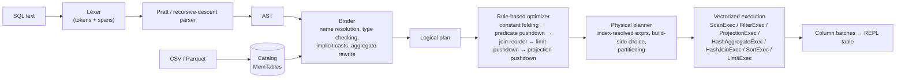

# sqlengine

[](https://github.com/TejasBaid/vectorized-sql-engine/actions/workflows/ci.yml)

A vectorized, multi-threaded SQL query engine written from scratch in Rust, in the spirit of DataFusion and DuckDB.
SQL text goes through a hand-written lexer and Pratt parser, a binder that type-checks it against a catalog, a
rule-based optimizer (constant folding, predicate and projection pushdown, cardinality-driven join reordering), and a
physical planner. The resulting plan runs on the engine's **own columnar batch format** (typed vectors plus validity
bitmaps, no Arrow) with morsel-driven parallel scans, parallel hash aggregation and partitioned hash joins. It reads
CSV (with type inference) and Parquet, ships an interactive REPL with `EXPLAIN ANALYZE`, and is tested against SQLite
and DuckDB. About 12k lines of Rust. Dependencies: `parquet` (page decoding only), `rustyline` (REPL), `mimalloc`
(allocator) and `bytes`, plus `rusqlite` for tests only.

```
sql> EXPLAIN ANALYZE SELECT l_orderkey, sum(l_extendedprice * (1 - l_discount)) AS revenue, ... -- TPC-H Q3, SF 1
...
HashJoinExec: Inner, on=[o_orderkey@2 = l_orderkey@0], build=left partitions=10  [rows=30382, batches=733, cpu=19.99ms]
  HashJoinExec: Inner, on=[c_custkey@0 = o_custkey@1], build=left partitions=10  [rows=145962, batches=184, cpu=9.76ms]
...
Execution: 10 rows in 12.18 ms using 10 partitions
```

## Features

- **SQL front end, written by hand.** A lexer that tracks line and column for every token, a recursive-descent parser
  for statements, and a Pratt parser for expressions with correct precedence for `OR/AND/NOT`, comparisons,
  `IS [NOT] NULL`, `[NOT] LIKE/ILIKE/IN/BETWEEN`, `||`, arithmetic, unary minus and `::` casts.
- **Supported SQL**
  - `SELECT [DISTINCT]` with expressions, `*` and `t.*`, `WHERE`, `GROUP BY` (expressions, ordinals, aliases),
    `HAVING`, `ORDER BY` (ASC/DESC, `NULLS FIRST/LAST`, ordinals, aliases, columns that are not in the select list),
    `LIMIT` and `OFFSET`.
  - `INNER`, `LEFT [OUTER]` and `CROSS` joins, comma joins, `ON` and `USING`, equi and non-equi conditions.
  - Subqueries in `FROM` and (non-recursive) `WITH` CTEs.
  - Aggregates: `COUNT(*)`, `COUNT([DISTINCT] x)`, `SUM`, `AVG`, `MIN`, `MAX`.
  - Expressions: `CASE` (both forms), `CAST`, `DATE '…'` and `INTERVAL '…' DAY|MONTH|YEAR` literals with date
    arithmetic, `EXTRACT`, `abs/round/floor/ceil/sqrt/upper/lower/length/trim/substr/coalesce/nullif/year/month/day`.
  - Full three-valued (Kleene) NULL logic, including `IN` lists that contain NULL.
  - `CREATE TABLE`, `CREATE TABLE AS SELECT`, `INSERT INTO … VALUES / SELECT`, `DROP TABLE [IF EXISTS]`,
    `SHOW TABLES`, `DESCRIBE`, `EXPLAIN [ANALYZE | VERBOSE]`.
  - Direct file queries: `SELECT * FROM 'data/lineitem.parquet'`, `read_csv('x.csv')`.
- **Binder and type checker.** It resolves names through scopes for tables, aliases, subqueries and CTEs, inserts
  implicit casts (`BIGINT→DOUBLE`, `'1995-03-15'→DATE` when compared with a date), and validates GROUP BY. Errors
  carry source positions and "did you mean" hints.
- **Optimizer.** Constant folding and boolean simplification, predicate pushdown (through projections, aliases and
  aggregates, into join sides and into scans, turning cross joins plus equalities into hash joins), LEFT→INNER join
  conversion for null-rejecting predicates, greedy join reordering based on estimated cardinality, top-k
  (`LIMIT` pushed into `ORDER BY`), and projection pushdown (column pruning).
- **Vectorized execution** over 8192-row batches. Operators: scan, filter, projection, hash aggregate, hash join
  (inner and left, with residual predicates), nested-loop join, sort (with top-k), limit, coalesce.
- **Parallelism.** Morsel-driven scans, pipelines that keep their partitioning across filter, projection and join
  probe, thread-local partial aggregation that is merged at the end, and a parallel hash-join build.
- **Data sources.** CSV with delimiter sniffing, type inference and automatic widening, decoded in parallel chunks.
  Parquet through the `parquet` crate's low-level column readers, decoded straight into the engine's own vectors,
  one row group per thread. DECIMAL, DATE, dictionary encoding, NULLs, Snappy and Zstd are all handled.
- **EXPLAIN ANALYZE** shows the optimized logical plan and the physical plan, with per-operator output rows, batch
  counts and CPU self time.
- **REPL** (rustyline): multi-line input, history, box-drawn result tables, timing, and dot commands
  (`.tpch 1` generates TPC-H data in memory, `.load t file.parquet`, `.threads N`, `.optimizer off`, …).

## Architecture



| Module | Responsibility |
|---|---|
| `sql/` | `lexer.rs` (tokens with spans), `ast.rs`, `parser.rs` (statements plus Pratt expression parser) |
| `logical/` | `binder.rs` (AST → typed `LogicalPlan`), `expr.rs` (bound expressions), `plan.rs` (plan nodes, EXPLAIN text) |
| `optimizer/` | one file per rule, plus `cardinality.rs` (selectivity and row estimates) |
| `physical/` | `ExecutionPlan` trait, metrics, `planner.rs`, `expr.rs` (vectorized evaluator), one file per operator |
| `column/` | `Column` (typed vector plus `Bitmap`), `StringData` (offsets and bytes), `Batch`, `Schema` |
| `compute/` | kernels: arithmetic, comparison, Kleene boolean logic, cast, LIKE, hashing, scalar functions |
| `datasource/` | CSV reader/writer with inference, Parquet reader (and writer for the data generator) |
| `session.rs` | user API: `Session::sql()`, DDL/DML, EXPLAIN |
| `tpch.rs`, `bin/` | TPC-H-like generator, `sqlengine` REPL, `tpchgen`, `bench` |

## Key design decisions and tradeoffs

**Own columnar format.** A `Column` is `ColumnData` (`Vec<i64>`, `Vec<f64>`, `Vec<i32>` for dates, `Vec<bool>`, or
offsets plus bytes for strings) and an optional packed validity bitmap, where `None` means no NULLs and enables fast
paths. NULL slots hold arbitrary values, so kernels run over the whole vector without branches and combine bitmaps
separately. Columns are `Arc`-shared, which makes projection and scans zero-copy. The cost: there is no zero-copy
interop with Arrow, and the type system is small (BIGINT, DOUBLE, VARCHAR, DATE, BOOLEAN; Parquet DECIMAL is read as
DOUBLE).

**Pull-based, batch-at-a-time execution.** Each operator's `execute(partition)` returns an iterator of batches
(Volcano, vectorized). I chose pull over push because it composes trivially: `LIMIT` stops pulling, operators stay
self-contained, and one virtual call is amortized over 8192 rows. Push-based pipelines (HyPer, DuckDB) make operator
fusion and pipeline scheduling easier. Here, parallelism comes from **partitioning** instead: streaming operators
preserve their input partitions, so `scan → filter → project → hash-join probe` runs on N threads with no exchange
operator, and pipeline breakers (aggregate, sort, join build) drain all partitions concurrently.

**Morsel-driven scans.** Partitions do not own a fixed range. They claim the next batch from a shared atomic cursor.
This matters on Apple Silicon, where performance and efficiency cores run at very different speeds: static
partitioning would leave P-cores idle while E-cores finish their share.

**Parallel hash aggregation.** Each input partition builds a thread-local table, so the hot path has no
synchronization, and the tables are merged at the end. Group lookup is vectorized: key columns are hashed column at
a time, then a hash → group-id table with collision chains is checked against typed per-group key storage. A single
BIGINT or DATE key gets a direct `i64` map. Accumulators are columnar (`state[group_ids[i]] += v[i]`), and additive
ones keep **4 interleaved lanes per group**. With few groups (TPC-H Q1 has 4), consecutive rows would otherwise
serialize on one load-add-store dependency chain. Profiling (`sample`) showed this was the top cost. Together with the typed group keys, lanes cut Q1's
aggregation CPU time by about 35%. Tradeoff: the final merge is single-threaded, which costs extra with millions of groups
(radix-partitioned merging is future work).

**Hash join.** The build side, chosen as the smaller estimated input for inner joins, is drained once in parallel
(`OnceLock`, so the first probe partition to arrive builds while the others wait), concatenated, and indexed as
`hash → head row` plus a `next` chain array. Probe partitions share the immutable table. NULL keys never match,
residual non-equi predicates are applied to candidate pairs, and LEFT joins emit unmatched probe rows with NULL build
columns. A single-BIGINT-key fast path avoids generic key comparison.

**Names in the logical plan, indices in the physical plan.** Logical expressions refer to columns by
`(qualifier, name)`, which keeps rewrites simple: pushing a filter through a projection is substitution, and join
reordering only needs a final projection to restore column order. The physical planner resolves everything to column
indices once, so execution never looks up names.

**Type checking up front.** The binder inserts every implicit cast, so kernels are monomorphic (`i64 op i64`,
`f64 op f64`, `date ± days`) and never dispatch on mixed types per row. `column <op> constant` has dedicated kernels
and never materializes a broadcast vector.

**Heuristic optimizer.** There are no histograms. Estimates use table row counts and fixed selectivities, and assume
foreign key to primary key joins. Join reordering is greedy: start from the smallest relation and repeatedly add the
smallest relation *connected* by an equi-join predicate, which avoids cross products. On Q3 this produces the
textbook plan (customer ⋈ orders, then lineitem), with hash tables built on the small sides.

**SQL semantics.** These follow PostgreSQL, SQLite and DuckDB where they agree: integer division truncates, division
by zero yields NULL, `ASC` sorts NULLs last, and integer overflow in `+ - *` or `SUM` is an error rather than
silent wraparound.

## Example session

```text
$ cargo run --release
sqlengine 0.1.0 — vectorized SQL engine. Type .help for help.
sql> .tpch 1
  customer       150000 rows
  orders        1500000 rows
  lineitem      6000098 rows
generated TPC-H SF 1 in 1.19s
sql> SELECT o_orderpriority, count(*) AS orders, round(avg(o_totalprice), 2) AS avg_price
...> FROM orders WHERE o_orderdate >= DATE '1995-01-01' GROUP BY 1 ORDER BY 1;
┌─────────────────┬────────┬───────────┐
│ o_orderpriority │ orders │ avg_price │
│ VARCHAR         │ BIGINT │ DOUBLE    │
├─────────────────┼────────┼───────────┤
│ 1-URGENT        │ 163476 │ 151270.19 │
│ 2-HIGH          │ 163869 │ 150976.04 │
│ 3-MEDIUM        │ 162888 │ 150944.28 │
│ 4-NOT SPECIFIED │ 163088 │ 151128.66 │
│ 5-LOW           │ 163823 │ 151179.58 │
└─────────────────┴────────┴───────────┘
5 rows (6.98 ms)
sql> EXPLAIN ANALYZE SELECT l_orderkey, sum(l_extendedprice * (1 - l_discount)) AS revenue, o_orderdate, o_shippriority
...> FROM customer, orders, lineitem
...> WHERE c_mktsegment = 'BUILDING' AND c_custkey = o_custkey AND l_orderkey = o_orderkey
...>   AND o_orderdate < DATE '1995-03-15' AND l_shipdate > DATE '1995-03-15'
...> GROUP BY l_orderkey, o_orderdate, o_shippriority ORDER BY revenue DESC, o_orderdate LIMIT 10;
== Optimized Logical Plan ==
Limit: skip=0, fetch=10
  Sort: revenue DESC, o_orderdate ASC fetch=10
    Projection: l_orderkey, sum(l_extendedprice * (1.0 - l_discount)) AS revenue, o_orderdate, o_shippriority
      Aggregate: groupBy=[l_orderkey, o_orderdate, o_shippriority], aggr=[sum(l_extendedprice * (1.0 - l_discount))]
        Inner Join: on=[orders.o_orderkey = lineitem.l_orderkey]
          Inner Join: on=[customer.c_custkey = orders.o_custkey]
            TableScan: customer projection=[c_custkey, c_mktsegment] filters=[c_mktsegment = 'BUILDING']
            TableScan: orders projection=[o_orderkey, o_custkey, o_orderdate, o_shippriority] filters=[o_orderdate < DATE '1995-03-15']
          TableScan: lineitem projection=[l_orderkey, l_extendedprice, l_discount, l_shipdate] filters=[l_shipdate > DATE '1995-03-15']

== Physical Plan (analyzed) ==
LimitExec: skip=0, fetch=10  [rows=10, batches=1, cpu=0.00ms]
  SortExec: revenue@1 DESC, o_orderdate@2 ASC, fetch=10  [rows=10, batches=1, cpu=0.05ms]
    ProjectionExec: l_orderkey@0, sum(l_extendedprice * (1.0 - l_discount))@3, o_orderdate@1, o_shippriority@2  [rows=11524, batches=2, cpu=0.00ms]
      HashAggregateExec: groups=[l_orderkey@6, o_orderdate@4, o_shippriority@5], aggs=[sum((l_extendedprice@7 * (1.0 - l_discount@8)))]  [rows=11524, batches=2, cpu=2.25ms]
        HashJoinExec: Inner, on=[o_orderkey@2 = l_orderkey@0], build=left partitions=10  [rows=30382, batches=733, cpu=19.99ms]
          HashJoinExec: Inner, on=[c_custkey@0 = o_custkey@1], build=left partitions=10  [rows=145962, batches=184, cpu=9.76ms]
            FilterExec: (c_mktsegment@1 = 'BUILDING') partitions=10  [rows=29919, batches=19, cpu=1.77ms]
              ScanExec: customer [c_custkey, c_mktsegment] partitions=10  [rows=150000, batches=19, cpu=0.07ms]
            FilterExec: (o_orderdate@2 < 1995-03-15) partitions=10  [rows=728401, batches=184, cpu=12.18ms]
              ScanExec: orders [o_orderkey, o_custkey, o_orderdate, o_shippriority] partitions=10  [rows=1500000, batches=184, cpu=0.15ms]
          FilterExec: (l_shipdate@3 > 1995-03-15) partitions=10  [rows=3236738, batches=733, cpu=38.65ms]
            ScanExec: lineitem [l_orderkey, l_extendedprice, l_discount, l_shipdate] partitions=10  [rows=6000098, batches=733, cpu=0.29ms]

Execution: 10 rows in 12.18 ms using 10 partitions (cpu = per-operator self time summed over threads)
sql> SELECT l_shipmode, count(*) FROM lineitem WHERE l_shipdate > '1998-12-01' + 1 GROUP BY 1;
Type error: cannot apply operator '+' to types VARCHAR and BIGINT (line 1, column 75)
  SELECT l_shipmode, count(*) FROM lineitem WHERE l_shipdate > '1998-12-01' + 1 GROUP BY 1;
                                                                            ^
sql> SELECT c_name, sum(o_totalprice) FROM customer JOIN orders ON c_custkey = o_custkey GROUP BY c_nam;
Binder error: column "c_nam" not found (did you mean "c_name"?) (line 1, column 94)
  SELECT c_name, sum(o_totalprice) FROM customer JOIN orders ON c_custkey = o_custkey GROUP BY c_nam;
                                                                                               ^^^^^
```

The comma join written in the query became two hash joins. All three filters were pushed into the scans, and each
scan reads only the columns it needs. The most selective relation (customer) is joined first, and both hash tables
are built on the smaller input.

## Build, run, test

```bash
cargo build --release
cargo run --release                                   # REPL
cargo run --release -- --tpch 0.1                     # REPL with generated TPC-H tables
cargo run --release -- --load t=data/t.parquet -c "SELECT count(*) FROM t"

cargo test                                            # all tests
cargo clippy --all-targets -- -D warnings && cargo fmt --check

# data + benchmarks
cargo run --release --bin tpchgen -- --sf 1 --out data/sf1 --format both
cargo run --release --bin bench -- --data data/sf1 --format parquet --runs 10
bench/run_all.sh                                      # everything in the table below (+ DuckDB if installed)
python3 bench/slt_vs_duckdb.py                        # cross-check .slt expectations against DuckDB
```

CI (`.github/workflows/ci.yml`) runs fmt, clippy with `-D warnings`, and the build and test suite on Linux and macOS,
plus a smoke run of the generator, the benchmark and `EXPLAIN ANALYZE`.

## Testing

| Suite | What it checks |
|---|---|
| unit tests (`src/**`, 24) | lexer spans and errors, date math, bitmaps, kernels (NULL propagation, division by zero, overflow ignored in NULL slots), the full 3×3 Kleene AND/OR truth table, casts, LIKE matcher, CSV inference and widening, sort NULL ordering, top-k = prefix of full sort |
| `tests/parser.rs` (9) | precedence and associativity (rendered as fully parenthesized trees), statement shapes, implicit aliases, **error positions** (line and column of the offending token) |
| `tests/optimizer.rs` (12) | each rule's plan shape (folding, pushdown through projections, aliases and aggregates, cross→equi join, LEFT→INNER, ON-clause handling, pruning, join order, top-k), and that every query returns identical results with the optimizer on and off |
| `tests/slt/*.slt` (156 records, 8 files) | sqllogictest-style end-to-end suite: expressions, NULL semantics, DDL/DML, aggregates, joins, subqueries, CTEs, ORDER BY corner cases, error messages, EXPLAIN shapes. The 99 expected query results were **cross-checked against DuckDB** (`bench/slt_vs_duckdb.py`): 0 unexpected differences, plus 2 documented ones (DuckDB returns DOUBLE for `ceil(BIGINT)`; `SELECT *` with `USING`) |
| `tests/differential.rs` | **differential testing against SQLite**: 1,000 randomly generated queries (nested predicates with NULLs, arithmetic including `/` and `%`, `IN` with NULL, LIKE, joins, LEFT joins, GROUP BY / HAVING, `COUNT(DISTINCT)`, subqueries, ORDER BY with NULLS FIRST/LAST + LIMIT) over random tables with NULLs and duplicate keys. All match, and over 80% return non-empty results |
| `tests/tpch.rs` | Q1, Q3, Q6 and Q12 at SF 0.01 compared cell by cell with SQLite |
| `tests/parallel.rs` | 8-partition execution equals 1-partition execution on multi-batch tables (merge paths, join build sharing, LEFT-join probes) |
| `tests/datasources.rs` | Parquet **written by DuckDB** (DECIMAL, DATE, dictionary pages, NULLs, 3 row groups) decodes to DuckDB's own aggregates; Parquet/CSV round trips; parallel CSV parsing of a large file |

At SF 1 and SF 3, all four benchmark queries return the same results as DuckDB (checked by `bench/duckdb_compare.py`).

## Benchmarks

The dataset is a TPC-H-*like* generator (`src/tpch.rs`), not the official `dbgen`. It produces customer, orders and
lineitem with spec-like distributions, so selectivities are realistic (Q1 touches about 98% of lineitem, Q6 about 2%).
The queries are TPC-H Q1, Q3, Q6 and Q12 ([`bench/queries/`](bench/queries)), unmodified apart from the standard
parameter substitution. All data is loaded from Parquet into memory first. Times are wall clock per query after one
warm-up, and include planning and result materialization.

**Setup:** Apple M4 (10 cores: 4 performance + 6 efficiency), 16 GiB, macOS, otherwise idle (1-minute load average
1.2–1.5 before the run, rising to 4.3 by the end from the benchmark's own threads; sampled every 10 s). sqlengine uses
10 partitions. DuckDB v1.5.6 CLI runs on in-memory tables created from the same Parquet files, timed with `.timer on`
(1 ms resolution, includes printing the small result), so DuckDB times below ~5 ms are coarse. Both engines operate
on DOUBLE columns here. 10 runs per query after one warm-up. Raw output, including the load samples:
[`bench/results/2026-10-15-m4.md`](bench/results/2026-10-15-m4.md).

| Query | SF | sqlengine min / median (ms) | DuckDB min / median (ms) |
|---|---:|---:|---:|
| Q1  | 0.1 | 2.5 / 2.5     | 5 / 6     |
| Q3  | 0.1 | 1.0 / 1.1     | 3 / 4     |
| Q6  | 0.1 | 0.2 / 0.2     | <1 / 1    |
| Q12 | 0.1 | 1.4 / 1.4     | 4 / 4     |
| Q1  | 1   | 22.5 / 22.8   | 28 / 29   |
| Q3  | 1   | 7.8 / 7.8     | 11 / 12   |
| Q6  | 1   | 1.7 / 1.7     | 4 / 4     |
| Q12 | 1   | 11.2 / 11.3   | 14 / 15   |
| Q1  | 3   | 66.7 / 68.0   | 80 / 83   |
| Q3  | 3   | 28.2 / 30.5   | 27 / 28   |
| Q6  | 3   | 5.2 / 6.0     | 11 / 11.5 |
| Q12 | 3   | 34.2 / 34.3   | 39 / 40.5 |

**Where DuckDB wins:** Q3 at SF 3 (27 / 28 ms vs 28.2 / 30.5 ms). This is the most join-heavy query at the largest
scale, where sqlengine's single (non-partitioned) hash table and single-threaded aggregate merge start to show. At
SF 0.1 the Q6 comparison is below DuckDB's timer resolution, so treat it as a tie. On the other queries sqlengine was
faster on this machine, by 1.2–3× at SF 1 and SF 3. Keep the context in mind: DuckDB is a far more complete system
(DECIMAL, spilling, full SQL), these are four queries on generated data, and sqlengine's wins come partly from doing
less (no DECIMAL arithmetic, everything memory-resident).

**Thread scaling** (sqlengine, SF 1, min of 5 runs, ms):

| Query | 1 thread | 2 | 4 | 8 | 10 | speedup 1→10 |
|---|---:|---:|---:|---:|---:|---:|
| Q1  | 133.8 | 67.8 | 35.9 | 25.5 | 22.4 | 6.0× |
| Q3  | 33.3  | 18.3 | 11.0 | 8.5  | 8.1  | 4.1× |
| Q6  | 6.6   | 3.7  | 2.5  | 1.8  | 1.7  | 3.9× |
| Q12 | 75.2  | 38.7 | 20.3 | 13.0 | 11.2 | 6.7× |

Scaling is close to linear up to 4 threads and flattens after that, partly because threads 5–10 land on efficiency
cores. Q6 is memory-bandwidth bound (6M rows in 1.7 ms).

**Loading** (SF 1, 6M-row lineitem): Parquet 0.31–0.34 s; CSV (800 MB, parallel parse with type inference) 0.60 s.
At SF 3 (18M rows), lineitem loads from Parquet in 1.2 s.

**Performance work along the way** (relative changes measured during development, on a busier machine): switching to mimalloc made Q1 about 1.4× faster and Q3 about 2× faster (the
macOS allocator contends when 10 threads allocate 64 KB vectors). Replacing per-row byte encoding of group keys with
vectorized hashing and typed key storage, plus lane-interleaved accumulators, reduced Q1's aggregation CPU time from
about 308 ms to about 200 ms (summed over threads, SF 1).

## Limitations and future work

- **Types:** no DECIMAL (Parquet decimals become DOUBLE), TIMESTAMP, or nested types.
- **SQL coverage:** no scalar, `IN` or `EXISTS` subqueries (only `FROM` subqueries and CTEs), no `UNION`/`INTERSECT`,
  no `RIGHT`/`FULL OUTER` join, no window functions. `SELECT *` over `JOIN … USING` keeps both key columns.
- **Memory:** tables are fully materialized in memory, and there is no spilling for large joins, aggregates or sorts.
  Parquet is decoded eagerly; streaming scans with row-group statistics pruning would be the next step.
- **Execution:** filters compact batches eagerly (no selection vectors or late materialization), there is no common
  subexpression elimination (Q1 computes `l_extendedprice * (1 - l_discount)` twice), the aggregate merge and the
  final sort run on one thread, and the hash join builds on a single table rather than radix partitions.
- **Optimizer:** heuristics only, with no statistics, histograms or NDV estimates, and greedy left-deep join ordering
  instead of DP enumeration (e.g. DPccp) over bushy trees.
- **Future work:** radix-partitioned parallel aggregation and join build, a push-based pipeline scheduler,
  decorrelation of subqueries, spill-to-disk operators, and a cost model fed by column statistics.

## License

MIT, see [LICENSE](LICENSE).
